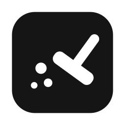
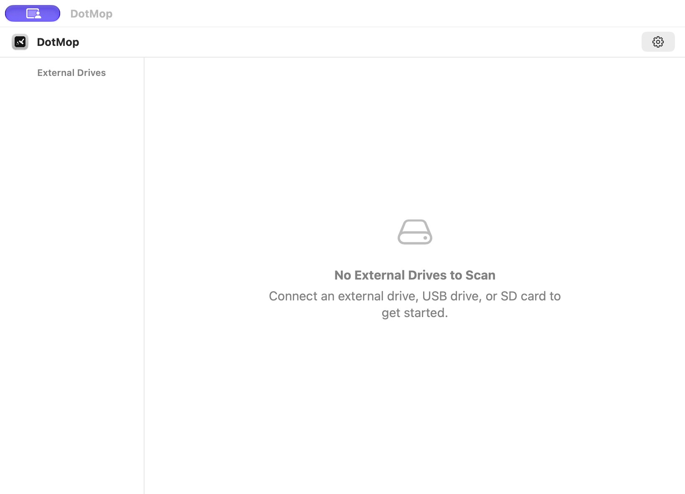
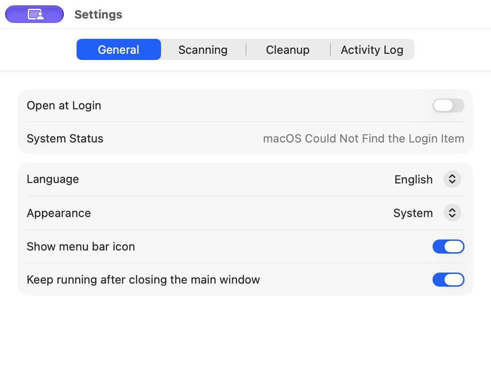

  

<h1 align="center">DotMop</h1>

A native macOS utility that scans USB drives, external disks, and SD cards for macOS metadata files you may want to remove.

<a href="README.md">简体中文</a> · <strong>English</strong> · <a href="https://github.com/niceyu123/DotMop/releases">Download / Releases</a>

## Download

DotMop requires **macOS 14.0 or later** on an **Apple silicon Mac (arm64)**. Find `DotMop-1.5-macOS-arm64.zip` on the [Releases page](https://github.com/niceyu123/DotMop/releases), unzip it, and drag `DotMop.app` to Applications.

The 1.5 preview build uses an Apple Development signature and has not been notarized by Apple. Gatekeeper may block it on another Mac. The release notes describe the signing status.

## Screenshots

The main window lists external drives and scan results. Settings covers scanning, cleanup, language, and appearance.

| Main window | Settings |
| --- | --- |
|  |  |

## Getting started

1. Open DotMop and connect an external drive. Allow access if macOS asks for permission to read removable volumes.
2. Select the drive and review the results. You can limit a scan to a folder and search for candidates by name or path.
3. Review the selection and move the chosen files to Trash. DotMop selects `.DS_Store` files by default. AppleDouble (`._*`) files require an explicit selection. Removing them can discard resource forks, Finder information, or extended attributes.

DotMop works offline. It scans automatically at launch and when you connect a drive. Automatic cleanup is opt-in. Read-only volumes, such as NTFS mounted by macOS, can be scanned. Cleanup requires a writable mount. If macOS cannot move files to Trash, the operation log links to the recovery folder on the original drive.

## Build from source

Open `DotMop.xcodeproj` in Xcode with Swift 6 support. Select the shared `DotMop` scheme and build for your Mac. The [Chinese user and developer guide](docs/使用与开发.md) covers packaging, scan boundaries, and file recovery.
