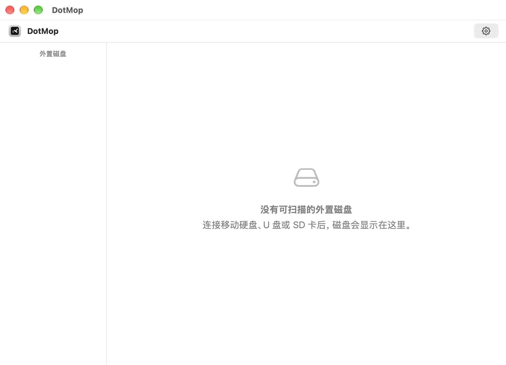
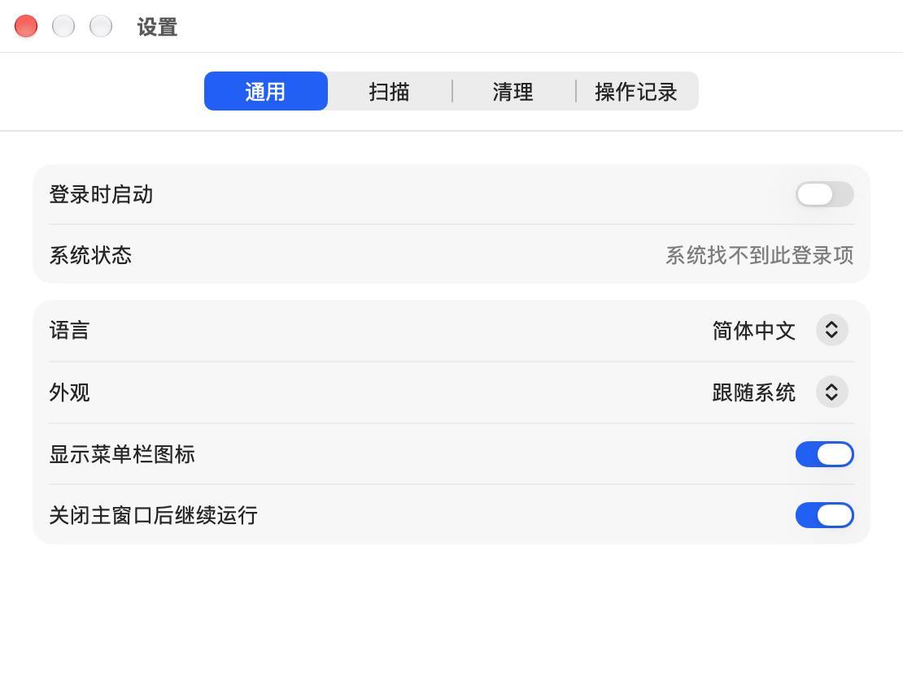

  

<h1 align="center">DotMop · 点点净</h1>

一款原生 macOS 工具，用来扫描和清理 U 盘、移动硬盘与 SD 卡里的 macOS 元数据文件。

<strong>简体中文</strong> · <a href="README.en.md">English</a> · <a href="https://github.com/niceyu123/DotMop/releases">下载 / Releases</a>

## 下载

适用于 **Apple Silicon Mac（arm64）**，要求 **macOS 14.0 或更新版本**。在 [Releases](https://github.com/niceyu123/DotMop/releases) 中找到 `DotMop-1.5-macOS-arm64.zip`，解压后将 `DotMop.app` 拖入「应用程序」。

1.5 预览包使用 Apple Development 签名，尚未通过 Apple 公证。在其他 Mac 上首次打开时，Gatekeeper 可能阻止运行。Release 页面会标明安装包的签名状态。

## 截图

主窗口显示外置磁盘和扫描结果。设置中可以调整扫描、清理、语言和外观偏好。

| 主窗口 | 设置 |
| --- | --- |
|  |  |

## 开始使用

1. 打开点点净，接入外置磁盘。如果 macOS 请求访问可移动宗卷，选择允许。
2. 选择磁盘，查看扫描结果。可限定到单个文件夹，按名称或路径查找候选文件。
3. 确认要处理的文件，再移入废纸篓。默认勾选 `.DS_Store`。AppleDouble（`._*`）需要手动选择，清理它可能移除资源分叉、Finder 信息或扩展属性。

点点净离线运行。默认在启动和接盘时自动扫描，自动清理需要主动开启。只读卷（例如 macOS 原生挂载的 NTFS）可扫描，清理需要卷以可写方式挂载。废纸篓提交失败时，可从操作记录定位原盘上的恢复文件夹。

## 从源码构建

用支持 Swift 6 的 Xcode 打开 `DotMop.xcodeproj`，选择共享的 `DotMop` scheme，并以本机 Mac 为目标构建。构建、打包、扫描边界和恢复流程见[使用与开发指南](docs/使用与开发.md)。
